  

  
  
  

  

 

<table align="center">
<tr>
<td align="center" width="25%"><h1>90%+</h1>detection accuracy on dental X-rays</td>
<td align="center" width="25%"><h1>5+</h1>dental disease categories detected</td>
<td align="center" width="25%"><h1>3</h1>environments automated Dev • Staging • Prod</td>
<td align="center" width="25%"><h1>5</h1>certifications AWS • Cisco • AMD • Palo Alto</td>
</tr>
</table>

 

## 🧪 Projects I've Shipped

  

  

  

 

## 🧰 Toolbox

<table>
<tr><td><b>Languages</b></td><td></td></tr>
<tr><td><b>Frontend</b></td><td></td></tr>
<tr><td><b>Backend</b></td><td> &nbsp;REST • JWT • OAuth • RBAC</td></tr>
<tr><td><b>Data & Queues</b></td><td> &nbsp;BullMQ • WebSockets</td></tr>
<tr><td><b>Cloud & DevOps</b></td><td></td></tr>
<tr><td><b>AI / ML</b></td><td>YOLOv11 • Segment Anything Model (SAM)</td></tr>
<tr><td><b>Core CS</b></td><td>DSA • OOP • DBMS • Operating Systems • Computer Networks</td></tr>
</table>

 

## 🏅 Certifications

| 🏆 Certification | 📅 When |
|---|---|
| AWS Certified Solutions Architect – Associate | May 2026 |
| AWS Certified Cloud Practitioner | May 2026 |
| Cisco CCNA – Networking, Routing, Switching & Security | May – Jun 2026 |
| AMD AI Academy Certification (Hackingly) | 2026 |
| Palo Alto Networks – Cybersecurity Foundation | Jun 2025 |

 

## 📊 GitHub, Live

  

  

  

 

  

