  

  
  
  

  

 

<table align="center">
<tr>
<td align="center" width="25%"><h1>90%+</h1>detection accuracy on dental X-rays</td>
<td align="center" width="25%"><h1>5+</h1>dental disease categories detected</td>
<td align="center" width="25%"><h1>3</h1>environments automated Dev • Staging • Prod</td>
<td align="center" width="25%"><h1>5</h1>certifications AWS • Cisco • AMD • Palo Alto</td>
</tr>
</table>

 

## 🧪 Projects I've Shipped

  

  

  

 

<h2 align="center">🧰 Toolbox</h2>

  
  
  
  

  
  

  
  

  
  
  
  
  

## 🏅 Certifications

| 🏆 Certification | 📅 When |
|---|---|
| AWS Certified Solutions Architect – Associate | May 2026 |
| AWS Certified Cloud Practitioner | May 2026 |
| Cisco CCNA – Networking, Routing, Switching & Security | May – Jun 2026 |
| AMD AI Academy Certification (Hackingly) | 2026 |
| Palo Alto Networks – Cybersecurity Foundation | Jun 2025 |

 

## 📊 GitHub, Live

  

  

  

 

  

